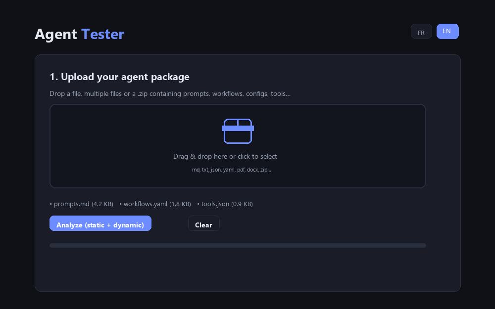

# Agent Tester


-6c8cff)

> Évalue un **package d'agent IA** (prompts, workflows, configs…) en deux temps : une **analyse statique par LLM**, puis des **tests dynamiques générés et exécutés automatiquement** — le tout dans une page web unique, sans backend.

🌍 *This README is also available in [English](README.md).*

🚀 **Démo en ligne :** [https://sergio744.github.io/Agent-Tester/](https://sergio744.github.io/Agent-Tester/) — ouvre l'URL, dépose un package, clique *Analyser*.



*(Aperçu illustratif : images re-rendues avec les styles et couleurs de l'app ; données d'exemple, pas une analyse réelle.)*

## À quoi ça sert

Tu as construit un agent (Custom GPT, LangChain, CrewAI, AutoGen… peu importe la forme : un dossier de prompts, un YAML de config, un zip de workflows) et tu veux savoir s'il est **clair, robuste et sécurisé** avant de t'y fier. Agent Tester :

1. lit ton package,
2. le fait analyser par un modèle puissant (scores, forces, faiblesses, risques),
3. génère automatiquement de 8 à 20 cas de test (dont jailbreak / prompt injection / cas limites / multilingue),
4. exécute ces tests contre une **simulation** de ton agent ou ton **endpoint réel**,
5. fait juger chaque réponse, puis produit un **rapport exportable** (Markdown, PDF, cloud Puter).

## Fonctionnalités

- Upload glisser-déposer : `.md`, `.txt`, `.json`, `.yaml`/`.yml`, `.csv`, et `.zip` (exploré fichier par fichier avec JSZip)
- `.pdf` / `.docx` acceptés (téléversés sur Puter FS — contenu binaire non lu, voir *Limites*)
- Extraction automatique du prompt système par heuristiques (`system_prompt:`, `"system": "…"`, `instructions:`, `You are a/an/the…`, avec repli sur le début du premier fichier)
- **Analyse statique** : vue d'ensemble, scores 0–10 (6 critères + score global), points forts, points faibles & risques, edge cases problématiques, recommandations priorisées
- **Tests dynamiques** couvrant : capacités principales, cas limites, tentatives de jailbreak / prompt injection, cohérence et refus appropriés, comportement multilingue, hallucinations potentielles, respect des workflows
- Deux modes d'exécution :
  - **Simulation** — le prompt système extrait est rejoué par le modèle d'évaluation (Puter AI) ;
  - **Endpoint personnalisé** — chaque test est envoyé en `POST` JSON vers ton agent réel (header `Authorization` optionnel). Réponses reconnues : `choices[0].message.content`, `response`, `message`, sinon JSON brut affiché tel quel.
- Verdict automatique par test : **PASS / FAIL / WARN** + commentaire court
- Rapport final en Markdown rendu à l'écran, avec trois exports : téléchargement `.md`, sauvegarde dans Puter (`Agent-Tester-Reports/`), impression / PDF
- Interface bilingue **FR / EN** (boutons en haut), thème sombre, responsive
- 100 % client : un seul fichier `index.html`, rien à installer, aucune clé API, aucun build

## Démarrage rapide

1. Ouvre [la démo en ligne](https://sergio744.github.io/Agent-Tester/) — ou ouvre `index.html` dans un navigateur moderne (connexion internet requise pour les CDN et l'IA).
2. Dépose ton package (un ou plusieurs fichiers, ou un zip).
3. Choisis le modèle d'évaluation, le mode de test et le nombre de tests.
4. Clique **Analyser**. À la première utilisation de l'IA, Puter demande de se connecter : c'est le modèle **User-Pays** — chaque visiteur consomme ses propres crédits IA, le site n'héberge ni ne paie rien (cf. [developer.puter.com](https://developer.puter.com/)).
5. Lis le rapport, puis exporte-le en `.md`, en PDF, ou sauvegarde-le dans ton espace Puter.

## Modes de test dynamique

| Mode | Principe | À quoi ça sert |
|---|---|---|
| Simulation | Le prompt système extrait de ton package est envoyé comme message `system` au modèle d'évaluation. | Tester la qualité du prompt lui-même, sans déployer l'agent. |
| Endpoint personnalisé | Chaque test part en POST JSON vers ton agent réel, avec le prompt système extrait en `system`. | Tester ton agent déployé, tel qu'il répond en production. |

## Confidentialité

- Le **texte** de tes fichiers est transmis au modèle d'évaluation choisi, via Puter.
- En mode endpoint personnalisé, les prompts de test et l'en-tête d'authentification éventuel partent vers l'URL que **tu** indiques.
- Les PDF / DOCX sont téléversés vers ton Puter FS (dossier `agent-tester-temp/`).
- ⚠️ Le rapport est rendu avec `marked` **sans sanitisation** : n'analyse que des packages dont tu connais la provenance.

## Limites connues

- L'analyse statique ne voit que les **55 000 premiers caractères** du package, la génération de tests les 22 000 premiers : les gros packages sont analysés partiellement.
- PDF / DOCX : seul le chemin Puter est transmis au modèle, le contenu n'est pas extrait côté navigateur.
- L'extraction du prompt système est une heuristique regex : sur un format inhabituel, elle retombe sur le début du premier fichier.
- Les options des menus déroulants ne sont pas traduites quand on passe en EN.
- Le verdict PASS / FAIL est produit par un LLM : non déterministe, à relire.
- Aucun timeout sur les appels vers l'endpoint personnalisé.

## Structure du dépôt

```
index.html   — toute l'application (HTML + CSS + JS)
docs/
  demo.gif            — aperçu animé (illustratif)
  social-preview.png  — image des cartes sociales
README.md
README.fr.md
LICENSE      — MIT
```

## Stack technique

- [Puter.js v2](https://developer.puter.com) — IA + stockage cloud, sans clé API (modèle User-Pays)
- [JSZip 3.10.1](https://cdnjs.cloudflare.com/ajax/libs/jszip/3.10.1/jszip.min.js) — lecture des `.zip`
- [marked](https://cdn.jsdelivr.net/npm/marked/marked.min.js) — rendu Markdown du rapport
- JavaScript vanilla — aucune dépendance npm, aucun build

## Licence

[MIT](LICENSE) — Copyright © 2026 Sergio744
