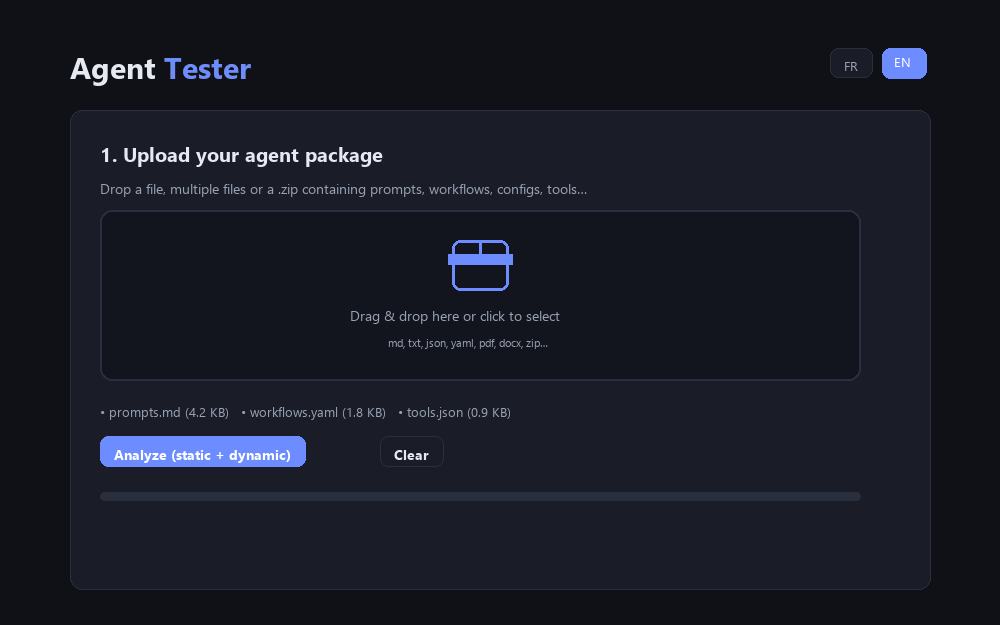

# Agent Tester


-6c8cff)

> Test an **AI agent package** (prompts, workflows, configs…) in two steps: a **static LLM analysis**, then **dynamic tests generated and executed automatically** — all in a single web page, no backend.

🌍 *Ce README existe aussi en [français](README.fr.md).*

🚀 **Live demo:** [https://sergio744.github.io/Agent-Tester/](https://sergio744.github.io/Agent-Tester/) — open the URL, drop a package, click *Analyze*.



*(Illustrative preview: frames re-rendered with the app's own styles and colors; sample data, not a live analysis.)*

## What it's for

You built an agent (Custom GPT, LangChain, CrewAI, AutoGen… any form: a folder of prompts, a YAML config, a zip of workflows) and you want to know whether it is **clear, robust and secure** before relying on it. Agent Tester:

1. reads your package,
2. has it analyzed by a strong model (scores, strengths, weaknesses, risks),
3. automatically generates 8 to 20 test cases (including jailbreak / prompt injection / edge cases / multilingual),
4. runs those tests against a **simulation** of your agent or your **real endpoint**,
5. has every answer judged, then produces an **exportable report** (Markdown, PDF, Puter cloud).

## Features

- Drag & drop upload: `.md`, `.txt`, `.json`, `.yaml`/`.yml`, `.csv`, and `.zip` (browsed file by file with JSZip)
- `.pdf` / `.docx` accepted (uploaded to Puter FS — binary content is not read, see *Limitations*)
- Automatic system-prompt extraction with heuristics (`system_prompt:`, `"system": "…"`, `instructions:`, `You are a/an/the…`, falling back to the start of the first file)
- **Static analysis**: overview, 0–10 scores (6 criteria + overall), strengths, weaknesses & risks, problematic edge cases, prioritized recommendations
- **Dynamic tests** covering: core capabilities, edge cases, jailbreak / prompt injection attempts, coherence and proper refusals, multilingual behavior, potential hallucinations, workflow compliance
- Two execution modes:
  - **Simulation** — the extracted system prompt is replayed by the evaluation model (Puter AI);
  - **Custom endpoint** — each test is sent as a `POST` JSON request to your real agent (optional `Authorization` header). Recognized responses: `choices[0].message.content`, `response`, `message`, otherwise raw JSON is displayed.
- Automatic verdict per test: **PASS / FAIL / WARN** + short comment
- Final Markdown report rendered on screen, with three exports: download `.md`, save to Puter (`Agent-Tester-Reports/`), print / PDF
- Bilingual **FR / EN** interface (buttons at the top), dark theme, responsive
- 100% client-side: one `index.html` file, nothing to install, no API key, no build

## Quick start

1. Open [the live demo](https://sergio744.github.io/Agent-Tester/) — or open `index.html` in a modern browser (internet required for the CDN scripts and the AI).
2. Drop your package (one or more files, or a zip).
3. Pick the evaluation model, the test mode and the number of tests.
4. Click **Analyze**. On first AI use, Puter asks you to sign in: that's the **User-Pays** model — each visitor consumes their own AI credits, the site hosts and pays nothing (see [developer.puter.com](https://developer.puter.com/)).
5. Read the report, then export it as `.md`, PDF, or save it to your Puter space.

## Dynamic test modes

| Mode | How it works | Use case |
|---|---|---|
| Simulation | The system prompt extracted from your package is sent as the `system` message to the evaluation model. | Test the quality of the prompt itself, without deploying the agent. |
| Custom endpoint | Every test is POSTed as JSON to your real agent, with the extracted system prompt as `system`. | Test your deployed agent exactly as it answers in production. |

## Privacy

- The **text** of your files is sent to the evaluation model you pick, via Puter.
- In custom-endpoint mode, the test prompts and any authentication header go to the URL **you** enter.
- PDF / DOCX files are uploaded to your Puter FS (`agent-tester-temp/` folder).
- ⚠️ The report is rendered with `marked` **without sanitization**: only analyze packages whose provenance you trust.

## Known limitations

- Static analysis only sees the **first 55,000 characters** of the package; test generation sees the first 22,000: large packages are partially analyzed.
- PDF / DOCX: only the Puter path is passed to the model, the content is not extracted in the browser.
- System-prompt extraction is regex-based heuristics: on unusual formats it falls back to the beginning of the first file.
- Dropdown options are not translated when switching to EN.
- The PASS / FAIL verdict comes from an LLM: not deterministic, review it.
- No timeout on calls to the custom endpoint.

## Repository structure

```
index.html   — the whole application (HTML + CSS + JS)
docs/
  demo.gif            — animated preview (illustrative)
  social-preview.png  — image used for social cards
README.md
README.fr.md
LICENSE      — MIT
```

## Tech stack

- [Puter.js v2](https://developer.puter.com) — AI + cloud storage, no API key (User-Pays model)
- [JSZip 3.10.1](https://cdnjs.cloudflare.com/ajax/libs/jszip/3.10.1/jszip.min.js) — reading `.zip` packages
- [marked](https://cdn.jsdelivr.net/npm/marked/marked.min.js) — Markdown rendering of the report
- Vanilla JavaScript — no npm dependency, no build step

## License

[MIT](LICENSE) — Copyright © 2026 Sergio744
